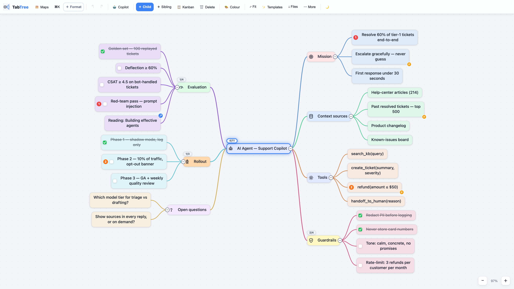
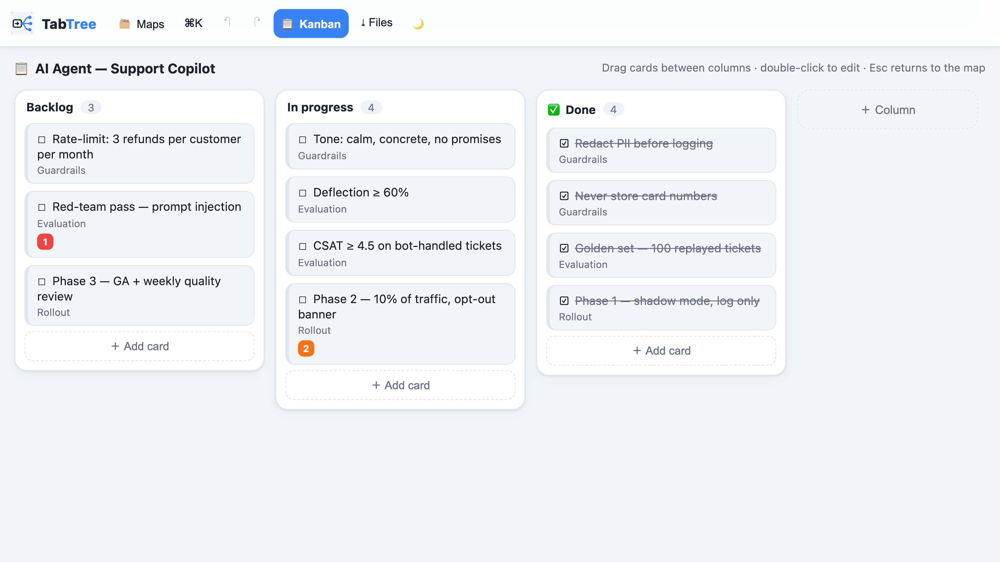
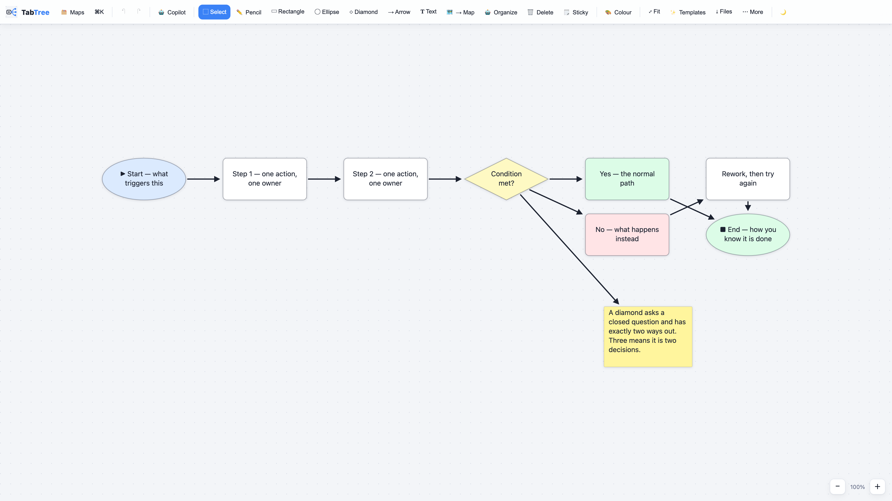
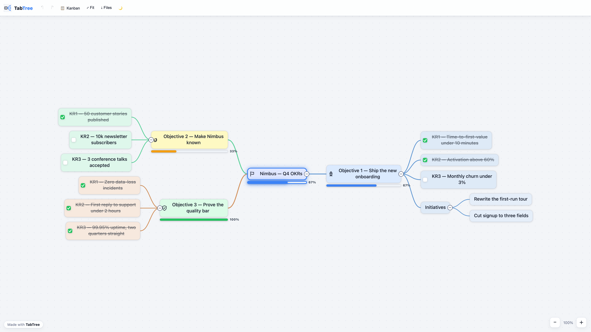
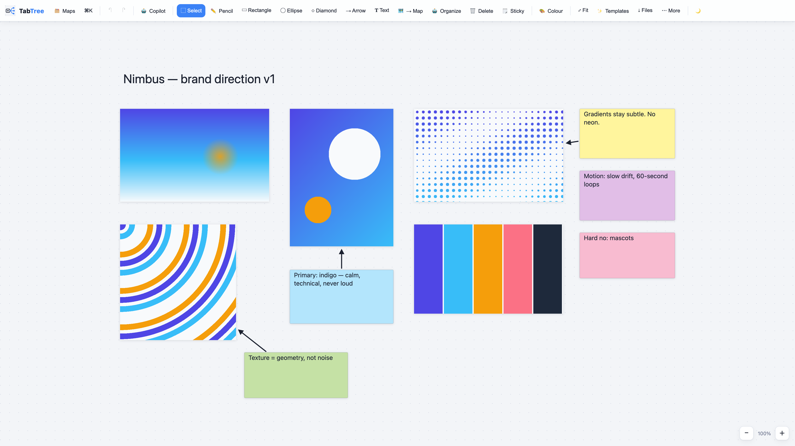
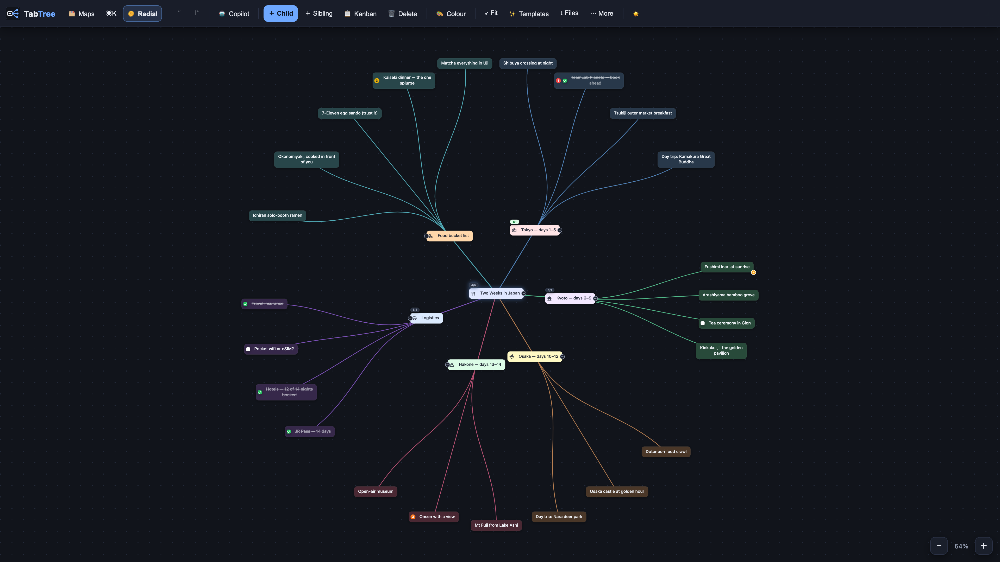

# TabTree

**Mind maps, kanban boards and whiteboards — one document, many views, in your account.**

[Live demo — no signup](https://tabtree.app/tabtree-demo.html?embed=1) · [tabtree.app](https://tabtree.app) · [Templates](templates/) · [Claude connector](#claude-connector)



---

## What it is

TabTree is a mind-mapping, kanban and whiteboard app at [tabtree.app](https://tabtree.app).
One document reads several ways: mind map, kanban board, Gantt chart, calendar, page of
notes, spreadsheet or full-screen presentation. Switch views; nothing is converted and
nothing is lost.

| | |
|---|---|
| **Your maps follow your account** | Sign in on your laptop or your phone and your library is there. |
| **Team spaces** | Invite people into a space: shared maps and boards, live presence, comments, a daily digest. |
| **Templates** | Business Model Canvas, Lean Canvas, OKRs, roadmaps, agent specs… [browse them](templates/) |
| **It leaves the building** | PNG posts, carousel PDFs, MP4 flythroughs, or a shared page anyone can read. |
| **Claude works in it** | The connector below lets Claude read your library and build maps, boards and kanbans in it. |

## This repository

TabTree itself is a commercial product and its source is not published here.
**This repository is the public face of it**, and it holds four things that are
useful on their own:

- **[`mcp/`](mcp/)** — the full source of the Claude connector, free to use, copy,
  redistribute and modify ([its own licence](mcp/LICENSE.md), no attribution required),
  and the same code published to npm as [`tabtree-mcp`](https://www.npmjs.com/package/tabtree-mcp).
- **[`plugins/tabtree/`](plugins/tabtree/)** — the Claude Code plugin: it ties a coding
  session to one card of a board (your commits land on it), ships the connector, and adds a
  facilitation skill that ends in a real document. See
  [Claude Code plugin](#claude-code-plugin) below.
- **[`templates/`](templates/)** — template outlines in plain Markdown, each with a
  link that opens it live. Paste them into TabTree, or into any outliner.
- **[`screenshots/`](screenshots/)** — rendered by the real app, not mocked up.

To see the app itself, [try the demo](https://tabtree.app/tabtree-demo.html?embed=1) — it runs
in your browser, with nothing to install and no signup.

<a name="claude-connector"></a>

## Claude connector

Let Claude read your TabTree library and turn a conversation, a transcript or a spec
into a real mind map, kanban board or whiteboard — in your account, on every device,
and in the team spaces you belong to.

**1. Get your connector key.** In TabTree: ⚙️ Settings → Account → **Claude connector** →
*Create a connector key*. It is shown once and starts with `tt_live_`.

**2. Claude Desktop — double-click.** Download
[`TabTree-Connector.mcpb`](https://github.com/ai4xedu/tabtree-mcp/releases/latest) (or from
[tabtree.app/connector](https://tabtree.app/connector/)) and double-click it. Claude Desktop
ships its own Node and asks for your key on its install screen.

**Claude Code, or any MCP client:**

```bash
claude mcp add tabtree --scope user -e TABTREE_API_KEY="tt_live_…" -- npx -y tabtree-mcp
```

Or in your client's config:

```json
{
  "mcpServers": {
    "tabtree": {
      "command": "npx",
      "args": ["-y", "tabtree-mcp"],
      "env": { "TABTREE_API_KEY": "tt_live_…" }
    }
  }
}
```

Twelve tools: `list_maps`, `read_map`, `search_maps`, `create_mindmap`, `plant_project`
(a brief becomes a tree — roots, branches, birds), `create_kanban`, `create_board` (with
your own images, and tables), `propose_changes`, `harvest`, `fill_knowledge`, `card_prompt`
and `deliver_card`. The connector **never overwrites or deletes a map**. Safe changes to an
existing map (add a card, move it, tick it, assign it, date it, comment on it) are applied by
TabTree itself while it is open, and Cmd+Z undoes them; anything that rewrites or removes
what someone wrote is shown to you first, as a banner on that map. Full detail in
[`mcp/README.md`](mcp/README.md).

<a name="claude-code-plugin"></a>

## Claude Code plugin

Ties a Claude Code session to **one card of a TabTree board**. Claude knows which card it is
working on — even after `/clear` — and your commits land on that card as a comment, without
you writing anything.

```bash
claude plugin marketplace add ai4xedu/tabtree-mcp
claude plugin install tabtree@tabtree
claude plugin configure tabtree
```

The third command asks for your connector key (`tt_live_…`, from TabTree → ⚙️ Settings →
Account → Claude connector). The key is kept by Claude Code, never written into a file of
your repository.

| Command | What it does |
|---|---|
| `/tabtree:link` | Links this git repository to one board — writes `.tabtree.json` (the board's id, no secret), so teammates share the link. |
| `/tabtree:next` | Picks the card to work on next, reads its brief, moves it to the in-progress column. |
| `/tabtree:status` | Says which board and card this session is tied to. |
| `/tabtree:done` | Writes the deliverable onto the card, for your approval in TabTree. |
| `atelier-vision-okr` | Facilitates a vision / mission / OKR session — in French, the language it was built to run workshops in — and writes the result as a canvas you can present. |

Once a repository is linked, each session starts with a one-paragraph summary of the board
and the current card, and the commits made during a session become one comment on the card:
hash, subject and branch — never a diff, a file or a secret. A hook never blocks a session:
when TabTree does not answer, Claude goes on without it. The connector itself ships inside the
plugin (the same `tabtree-mcp.mjs` as on npm), so the twelve tools above are in the session.

## Screenshots

**The same document as status columns — every card is still a node of the map.**



**Arrows stay attached to the boxes when you move them.**



**A shared map, as your reader sees it.**



**Images and reasoning on one canvas.**



**Radial layout, dark theme.**



## Licence

Different licences, and the distinction matters:

- The **connector** in [`mcp/`](mcp/) is free to use, copy, redistribute and modify,
  for any purpose — see [`mcp/LICENSE.md`](mcp/LICENSE.md). It is given away on purpose.
- The **plugin** in [`plugins/tabtree/`](plugins/tabtree/) carries the connector's licence
  file, and the workshop skill keeps its own
  ([`plugins/tabtree/skills/atelier-vision-okr/LICENSE.md`](plugins/tabtree/skills/atelier-vision-okr/LICENSE.md)):
  free on the same terms, commercial workshops included. Each text names what it covers.
- The **app** is a commercial service at [tabtree.app](https://tabtree.app); its source is
  **not** in this repository.
- The **template outlines** are yours to copy and adapt freely.

---

Made in Casablanca. [tabtree.app](https://tabtree.app)
