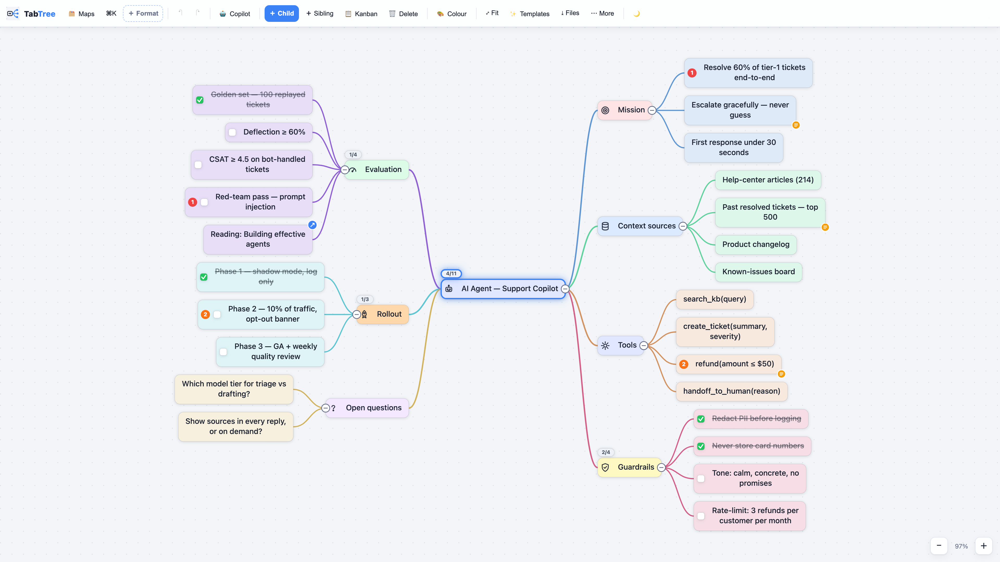
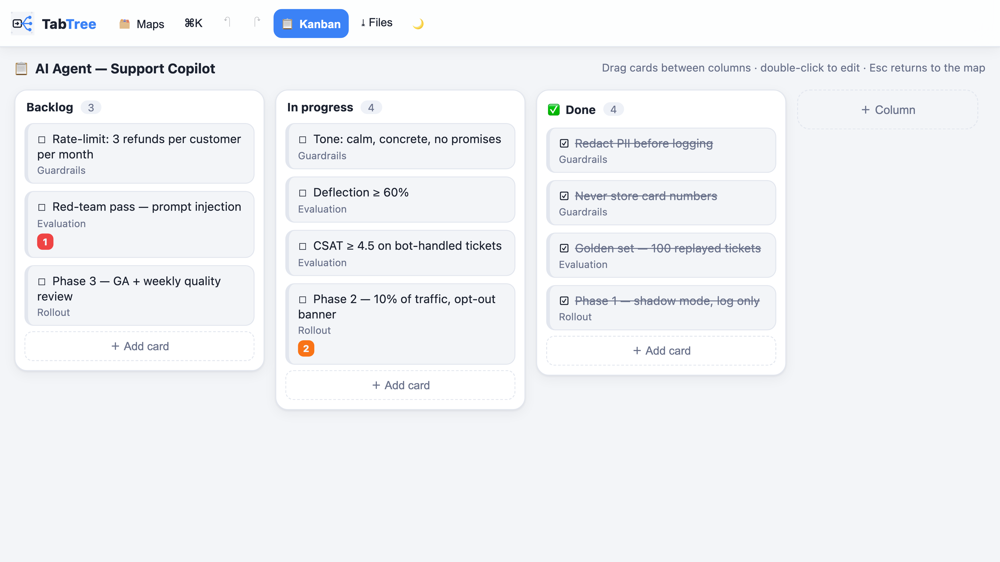
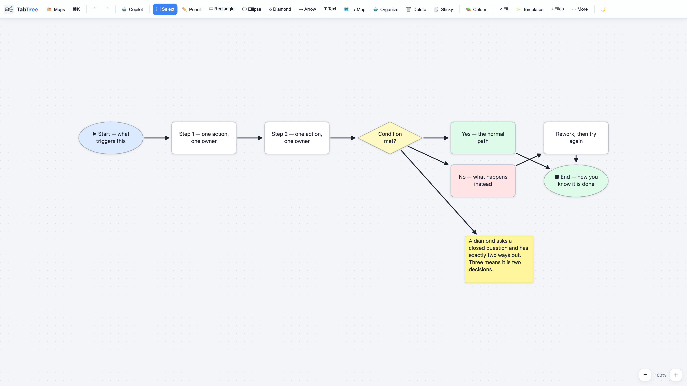
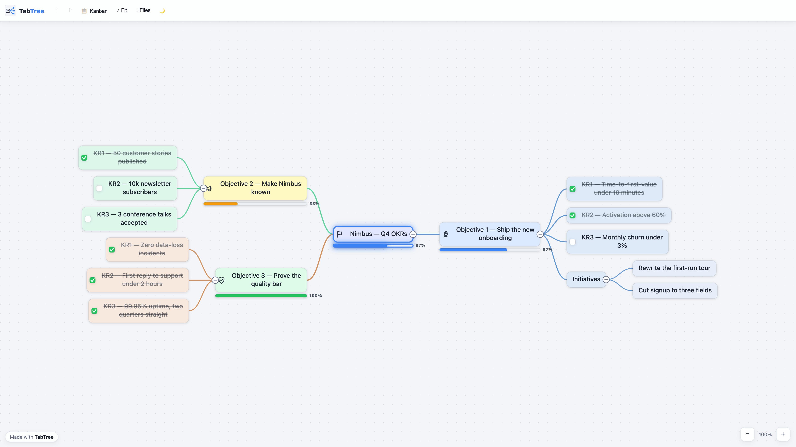
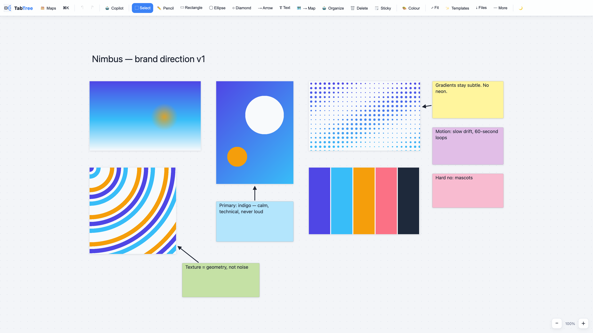
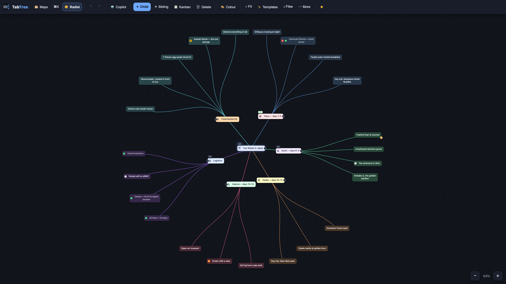

# TabTree

**Mind maps, kanban boards and whiteboards — one document, many views, in your account.**

[Live demo — no signup](https://tabtree.app/tabtree-demo.html?embed=1) · [tabtree.app](https://tabtree.app) · [Templates](templates/) · [Claude connector](#claude-connector)



---

## What it is

TabTree is a mind-mapping, kanban and whiteboard app at [tabtree.app](https://tabtree.app).
One document reads several ways: mind map, kanban board, Gantt chart, calendar, page of
notes, spreadsheet or full-screen presentation. Switch views; nothing is converted and
nothing is lost.

| | |
|---|---|
| **Your maps follow your account** | Sign in on your laptop or your phone and your library is there. |
| **Team spaces** | Invite people into a space: shared maps and boards, live presence, comments, a daily digest. |
| **Templates** | Business Model Canvas, Lean Canvas, OKRs, roadmaps, agent specs… [browse them](templates/) |
| **It leaves the building** | PNG posts, carousel PDFs, MP4 flythroughs, or a shared page anyone can read. |
| **Claude works in it** | The connector below lets Claude read your library and build maps, boards and kanbans in it. |

## This repository

TabTree itself is a commercial product and its source is not published here.
**This repository is the public face of it**, and it holds four things that are
useful on their own:

- **[`mcp/`](mcp/)** — the full source of the Claude connector, free to use, copy,
  redistribute and modify ([its own licence](mcp/LICENSE.md), no attribution required),
  and the same code published to npm as [`tabtree-mcp`](https://www.npmjs.com/package/tabtree-mcp).
- **[`plugins/tabtree/`](plugins/tabtree/)** — a Claude Code plugin: a facilitation
  skill that ends in a real document, plus the connector. See
  [Claude Code plugin](#claude-code-plugin) below.
- **[`templates/`](templates/)** — template outlines in plain Markdown, each with a
  link that opens it live. Paste them into TabTree, or into any outliner.
- **[`screenshots/`](screenshots/)** — rendered by the real app, not mocked up.

To see the app itself, [try the demo](https://tabtree.app/tabtree-demo.html?embed=1) — it runs
in your browser, with nothing to install and no signup.

<a name="claude-connector"></a>

## Claude connector

Let Claude read your TabTree library and turn a conversation, a transcript or a spec
into a real mind map, kanban board or whiteboard — in your account, on every device,
and in the team spaces you belong to.

**1. Get your connector key.** In TabTree: ⚙️ Settings → Account → **Claude connector** →
*Create a connector key*. It is shown once and starts with `tt_live_`.

**2. Claude Desktop — double-click.** Download
[`TabTree-Connector.mcpb`](https://github.com/ai4xedu/tabtree-mcp/releases/latest) (or from
[tabtree.app/connector](https://tabtree.app/connector/)) and double-click it. Claude Desktop
ships its own Node and asks for your key on its install screen.

**Claude Code, or any MCP client:**

```bash
claude mcp add tabtree --scope user -e TABTREE_API_KEY="tt_live_…" -- npx -y tabtree-mcp
```

Or in your client's config:

```json
{
  "mcpServers": {
    "tabtree": {
      "command": "npx",
      "args": ["-y", "tabtree-mcp"],
      "env": { "TABTREE_API_KEY": "tt_live_…" }
    }
  }
}
```

Eight tools: `list_maps`, `read_map`, `search_maps`, `create_mindmap`, `create_board`
(with your own images — logos, photos, posters), `create_kanban`, `propose_changes` and
`harvest`. The connector **never overwrites or deletes a map**. Safe changes to an existing
map (add a card, move it, tick it, assign it, date it) are applied by TabTree itself while
it is open, and Cmd+Z undoes them; anything that rewrites or removes what someone wrote is
shown to you first, as a banner on that map. Full detail in [`mcp/README.md`](mcp/README.md).

<a name="claude-code-plugin"></a>

## Claude Code plugin

A skill that does not end in advice — it ends in a **document in your TabTree account**.

```bash
/plugin marketplace add ai4xedu/tabtree-mcp
/plugin install tabtree@tabtree
```

| Skill | What it does |
|---|---|
| `atelier-vision-okr` | Facilitates a team session — vision, mission, pillars, OKRs per department, plan for the year — then writes it as a canvas you can present. |

It is written in **French**: it was built to run real workshops, and that is the language
it runs in. The canvas it produces follows the map's own language.

The plugin starts the connector, so it needs your connector key in `TABTREE_API_KEY`:

```bash
export TABTREE_API_KEY="tt_live_…"
```

Without it the connector says so plainly. If you only want the connector and not the
skill, the double-click [`.mcpb` bundle](#claude-connector) is the simpler route.

## Screenshots

**The same document as status columns — every card is still a node of the map.**



**Arrows stay attached to the boxes when you move them.**



**A shared map, as your reader sees it.**



**Images and reasoning on one canvas.**



**Radial layout, dark theme.**



## Licence

Different licences, and the distinction matters:

- The **connector** in [`mcp/`](mcp/) is free to use, copy, redistribute and modify,
  for any purpose — see [`mcp/LICENSE.md`](mcp/LICENSE.md). It is given away on purpose.
- The **skill** in [`plugins/tabtree/`](plugins/tabtree/) is free on the same terms,
  commercial workshops included — see
  [`plugins/tabtree/LICENSE.md`](plugins/tabtree/LICENSE.md). It has a separate licence
  because the connector's own text says it covers the connector only.
- The **app** is a commercial service at [tabtree.app](https://tabtree.app); its source is
  **not** in this repository.
- The **template outlines** are yours to copy and adapt freely.

---

Made in Casablanca. [tabtree.app](https://tabtree.app)
